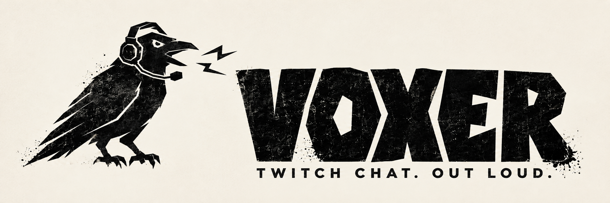

<p align="center">
  
</p>

<h1 align="center">VOXER</h1>

<p align="center"><strong>Your chat has something to say. Let it.</strong></p>
<p align="center">Self-hosted Twitch text-to-speech with a voice for every chatter and overlays made for OBS.</p>

<p align="center">
  <a href="#quick-start">🚀 Quick start</a> ·
  <a href="#docker">🐳 Docker</a> ·
  <a href="#obs">🎬 OBS setup</a> ·
  <a href="#configuration">⚙️ Configuration</a> ·
  <a href="#troubleshooting">🛠️ Help</a>
</p>

<p align="center">
  
</p>

<h2 align="center">🎙️ Give Chat a Voice</h2>

Keep your eyes on the game and your ears on chat. Voxer turns Twitch messages into speech on your machine, then plays them through a transparent OBS browser source. Each chatter gets a persistent voice, so your regulars sound like your regulars.

| What you get | What it does |
| :--- | :--- |
| 🗣️ Distinct voices | Ten built-in voices plus bundled custom styles, with assignments saved between streams. |
| 🌍 English & Ukrainian | Automatic language detection, spoken usernames, expanded abbreviations, and readable link announcements. Other languages fall back to Ukrainian. |
| 🔊 Chat commands & soundboard | Inline `!tts` speech and 49 bundled sound clips with `!sound` / `!s`, including aliases and ordered command sequences. |
| 🎉 Channel moments | Spoken follow, subscription, cheer, and raid announcements. Event announcement text is Ukrainian. |
| 🎬 Two overlay styles | A 3D speaker with glitch effects, or a lighter particle overlay. Both show the current chatter and support reduced motion. |
| 💬 Community reminders | Editable, weighted scheduled messages posted directly to chat. |
| 🏠 Your own setup | Local [Supertonic](https://pypi.org/project/supertonic/) speech synthesis, saved settings, and automatic Twitch token refresh. No external TTS API key. |

**One account, one channel:** Voxer runs in the channel owned by `TWITCH_BOT_USERNAME`. Use your streaming account's lowercase login and authorize that same account. Messages sent by that account are skipped, along with known bots and usernames containing `bot`.

<a name="quick-start"></a>
<h2 align="center">🚀 Quick Start</h2>

Install Docker with **Compose 2.24 or later** on Linux or macOS, then:

```bash
git clone https://github.com/worxbend/twitch-voxer.git
cd twitch-voxer
./voxer.sh start
```

The first start builds a local image and opens a private setup page in your **host browser**. No host Python, ffmpeg, `.env`, manual UID preparation, or token copying is needed. In a headless session, the launcher prints a single-use setup link; open it on the Docker host and keep it private.

1. Create an application in the [Twitch Developer Console](https://dev.twitch.tv/console/apps). Twitch requires a verified email and two-factor authentication; see its [registration guide](https://dev.twitch.tv/docs/authentication/register-app/).
2. Register **`http://localhost:4343/oauth/callback`** as its exact redirect URL.
3. Enter only the **Client ID** and **Client Secret** in Voxer's setup page.
4. Approve Twitch access using your **streaming/channel account**, then confirm the channel shown by Voxer. This remains a one-account/one-channel application, not a separate bot account.
5. Refresh the setup page while the speech model prepares. When it says **ready**, copy its generated **OBS Browser Source URL**. The overlay secret is generated once and retained across restarts.

For each later stream, run **`./voxer.sh start`**. It reuses the installed image, saved configuration, Twitch grant, and model cache; it neither builds nor pulls an image when the selected image is present. Repeated starts do not reopen your browser. Scheduled chat messages are **off by default**.

<a name="docker"></a>
<h2 align="center">🐳 Docker controls and storage</h2>

```bash
./voxer.sh status    # authorization, model, chat and OBS connection status
./voxer.sh stop      # retain settings and cache
./voxer.sh setup     # open a fresh private setup/reauthorization session
./voxer.sh prepare   # prepare the speech cache while Voxer is stopped
./voxer.sh emotes    # refresh emotes while stopped; reuse primary authorization
```

Keep the setup page open during first preparation; **Refresh status** shows progress and the OBS URL. If setup reports an error, fix the indicated component and stop/start to retry. Temporary Twitch outages retain your saved grant and retry within a bounded budget, rather than sending you straight back to consent. Genuine revoked permissions require `./voxer.sh setup`.

Compose publishes ports **8080** and **4343** on host loopback only. Private settings, tokens, voice assignments, reminders and emote cache live in the **`voxer-state` named volume** at `/data`. The speech model lives in **`tts-cache`**; generated audio uses bounded `/tmp` storage. Files containing credentials have mode `0600`. These files are plaintext: protect the volumes and their backups. **Do not use `docker compose down -v` unless you intend to erase them.**

The default image is **`twitch-voxer:local`**, not a published release. After changing source, explicitly rebuild with `docker compose build voxer`, then stop/start. You can select a separately supplied versioned image with `VOXER_IMAGE`; `./voxer.sh update` pulls that selection explicitly. Keep the previous image tag/digest for rollback. Public release publication, ARM64 execution, real Twitch/OBS checks, and stream-ready latency benchmarks are still pending; see [implementation status](tasks/implementation.md).

<details>
<summary><strong>Existing .env/bind mounts and local development</strong></summary>

Existing environment variables and `.env` files remain supported. Precedence is **environment > `.env` > saved setup > defaults**. An explicit blank or invalid override is not silently replaced. For browser enrollment, do not copy an example containing blank credential overrides into `.env`; either supply working values there or leave those keys absent.

Existing `./data` deployments are **not automatically migrated**. Stop the old service and keep its files. To retain a bind mount, create `compose.bind.yml`:

```yaml
services:
  voxer:
    volumes:
      - ./data:/data
```

Start with `docker compose -f docker-compose.yml -f compose.bind.yml up -d --build`; this replaces only the `/data` mount. Bind-mounted files must remain writable/readable by **UID 1000**. Never use broad `chmod 777` or overwrite an existing named-volume backup. The launcher uses the default named-volume configuration, so use the same explicit Compose files for controls in an advanced deployment.

For local development, install [uv](https://docs.astral.sh/uv/) and ffmpeg, then:

```bash
uv python install 3.14
uv sync --locked
uv run --frozen twitch-voxer
# In another terminal, obtain a private browser setup URL:
uv run --frozen python -m voxer.control setup-url
```

Local state defaults to `data/settings.json` and `data/tokens.json`. Use the setup page's protected OBS URL even for local installs. Change saved application credentials only while stopped; `.env`/environment overrides remain available for advanced configuration. For remote Docker, deliberately configure HTTPS or a local tunnel; the automatic launcher assumes Docker and your browser share a host.

</details>

<a name="obs"></a>
<h2 align="center">🎬 Add It to OBS</h2>

| Overlay | Local URL | Style |
| :--- | :--- | :--- |
| **Full** | `http://localhost:8080/` | 3D speaker, glitches, and emote effects. |
| **Simple** | `http://localhost:8080/simple` | Chatter card and particles with less graphics work. |

1. In OBS, add a [Browser Source](https://obsproject.com/kb/browser-source).
2. Paste an overlay URL. If you configured an overlay token, append `?token=YOUR_TOKEN`.
3. Match the source dimensions to your canvas, for example **1920 × 1080**. The background is transparent.
4. Disable **Shutdown source when not visible** to keep the connection alive while switching scenes.
5. Send a chat message from another account and check the audio in OBS.

At least one overlay must be connected for speech to be generated. Opening both overlays plays audio in both, so use one active audio source if you hear an echo.

<h3 align="center">Make it yours</h3>

| URL option | Example | Effect |
| :--- | :--- | :--- |
| `volume` | `?volume=0.7` | Playback volume from `0` to `1`; default `1`. |
| `debug` | `?debug=1` | Show connection status; `0` hides it. Hidden in OBS by default. |
| `token` | `?token=YOUR_TOKEN` | Sign in to a protected overlay. |

Combine options with `&`, for example:

```text
http://localhost:8080/simple?token=YOUR_TOKEN&volume=0.7&debug=0
```

The token is exchanged for a private browser cookie and removed from the address bar. Keep it in the saved OBS source URL so a fresh browser profile can sign in. Update that URL when you rotate the token.

In a regular browser, click **Enable Audio** or focus it and press Enter/Space if autoplay is blocked. Both overlays follow your system's reduced-motion preference while keeping speech and the chatter card available.

<a name="configuration"></a>
<h2 align="center">⚙️ Tune Your Stream</h2>

Settings come from the environment or `.env`. Restart Voxer after changing them. [`.env.example`](.env.example) contains the full list with explanations; these are the settings you'll most often want to adjust:

| Setting | Default | What it changes |
| :--- | :--- | :--- |
| `VOXER_MESSAGE_QUEUE_MAXSIZE` | `20` | Messages waiting for speech. New messages are dropped when full. |
| `VOXER_MAX_MESSAGE_AGE_SECS` | `60` | Maximum age of queued work, in seconds. |
| `VOXER_USER_COOLDOWN_SECS` | `2` | Minimum gap between accepted messages from one chatter; `0` disables it. |
| `VOXER_MAX_MESSAGE_CHARS` | `500` | Incoming message length limit. |
| `VOXER_MAX_SPEECH_CHARS` | `1000` | Length limit after text expansion. |
| `VOXER_ANNOUNCE_WINDOW_SECS` | `300` | Silence before a chatter's name is spoken again. |
| `VOXER_NO_ANNOUNCE_USERS` | Configured account | Comma-separated logins whose name prefix is skipped. Replaces the default list. |
| `VOXER_EMOTE_SOUND_PATHS` | Two bundled MP3s | Sounds for emote-only messages. An empty value disables them. |
| `VOXER_SOUNDS_DIR` | Bundled `voxer/sounds/` | Directory of predefined soundboard MP3s; replace files using the same filenames. |
| `VOXER_LOG_LEVEL` | `INFO` | Logging detail. |

<h3 align="center">🔊 TTS commands and soundboard</h3>

Anyone in chat can use these commands; no subscriber or moderator role is required.
The existing bot-account filters, per-user cooldown, message length limits, and
connected-overlay requirement still apply. Ordinary messages continue to use
automatic TTS.

| Chat message | Playback |
| :--- | :--- |
| `!tts Hello, chat!` | Speaks “Hello, chat!” using the chatter's current voice. |
| `hey !tts message to TTS` | Speaks only “message to TTS”, with the usual username announcement when due. |
| `!tts message !end !sound magic` | Speaks “message”, then plays `sparkle`. |
| `!s pop !tts That was fun !end` | Plays `pop`, then speaks “That was fun”. |
| `!tts first !end ignored text !tts second` | Speaks “first”, then “second”. |
| `!S : "woof-woof"!` | Plays `wan wan`. |

Commands can appear anywhere after whitespace, or at the start of a message.
`!tts` reads until `!end`, the next supported command, or the end of the message.
When a message contains supported commands, text before them and after `!end`
is ignored. `!end` is optional before another command. Unknown sound names and
empty command sections are skipped; later valid commands still run. Unknown
markers inside speech, such as `!unknown`, remain part of the speech text.

Both `!sound <name>` and `!s <name>` accept the names and aliases below. Matching
ignores case, accepts extra whitespace and optional `:` / `=` after the command,
and supports quoted sound names and trailing `.`, `!`, or `?`. Multiword sound
names also accept hyphens, underscores, or no separator: `choo choo`,
`choo-choo`, `choo_choo`, and `choochoo` all work. A sound argument must match
the entire name or alias; use another command or `!end` before adding prose.

| Sound | Aliases |
| :--- | :--- |
| `pop` | |
| `zap` | `quezacotl` |
| `sparkle` | `magic` |
| `ding` | |
| `crunch` | |
| `chirp` | |
| `choo choo` | |
| `splash` | |
| `tweet` | |
| `boing` | |
| `hush` | `shhh` |
| `ribbit` | `croak` |
| `doki doki` | |
| `wan wan` | `goodboy`, `goodgirl`, `arf arf`, `bark bark`, `woof woof` |
| `noted` | |
| `bang` | |
| `beep` | |
| `wow` | `anime wow` |
| `gong` | `asian gong` |
| `aww` | |
| `bruh` | |
| `buzzer` | |
| `chime` | `ding2` |
| `call` | `discord call` |
| `leave` | `discord leave` |
| `discord` | `discord notification`, `discord ping` |
| `join` | `discord join` |
| `wrong` | `incorrect`, `loud buzzer` |
| `fart` | |
| `gunshot` | `shot` |
| `iphone` | `iphone notification` |
| `meow2` | `meow 2` |
| `quack` | |
| `meow` | `meow1`, `meow 1` |
| `evil` | `evil laugh`, `muhehehe` |
| `nana` | `na na na` |
| `nope` | |
| `hellnah` | `hell nah` |
| `omg` | `oh my god` |
| `ohno` | `oh no`, `oh no laugh` |
| `punch` | |
| `rizz` | |
| `shocked` | `shock` |
| `thunder` | |
| `wait` | `wait wait`, `what the hell` |
| `champions` | `we are the champions` |
| `wetfart` | `wet fart` |
| `whip` | |
| `womp` | `womp womp`, `womp womp womp` |

`doki doki` plays a heartbeat, `wan wan` plays barking, and `noted` plays a
notification. The source checkout includes all 49 clips. The Docker context
includes only the 17 effects with supplied CC0 attribution; mount a private
custom sounds directory to use the other 32 clips after confirming your rights.
Do not publicly redistribute those clips or an unfiltered Python wheel without
license review. See [sound sources and credits](voxer/sounds/README.md)
for the original recordings and licenses.

A chat message's commands share one cooldown check and enter the queue in order.
If there is not enough queue space for the whole sequence, the sequence is
dropped. Sound effects use the same playback queue and volume setting as speech.

Emote-only messages automatically play a random notification from
`VOXER_EMOTE_SOUND_PATHS` (by default, `emotes/slack-message.mp3` and
`emotes/discord.mp3`) while displaying the resolved emotes. An empty setting
disables these notifications. The `!s discord` command uses the clip in
`voxer/sounds/discord.mp3`.

<h3 align="center">💬 Scheduled messages</h3>

Scheduled posting is disabled by default. Edit `VOXER_MESSAGES_PATH` to opt in:
`/data/messages.json` inside Docker, or [data/messages.json](data/messages.json) locally:

```json
{
  "messages": [
    {"text": "Welcome in! Make yourself at home. 👋", "frequency_per_hour": 1},
    {"text": "Hydration check. Take a sip! 💧", "frequency_per_hour": 0.5}
  ]
}
```

Voxer chooses messages randomly, weighted by `frequency_per_hour`. These values set an approximate average, rather than an exact timetable. Reminders are posted as chat text and are not spoken aloud. The file reloads each cycle, so edits do not require a restart.

Use `{"messages": []}` to disable posting. `VOXER_SCHEDULER_INITIAL_DELAY` defaults to **10 seconds**; an empty list is checked again after `VOXER_SCHEDULER_EMPTY_RETRY_DELAY`, default **600 seconds**.

<h3 align="center">🎭 Voices and emotes</h3>

Each new chatter receives a random voice from **M1–M5**, **F1–F5**, and the custom styles in [voices/](voices/). Assignments are saved in `data/voices.json`. Add compatible Supertonic voice-style JSON files to `voices/` and restart to expand the pool.

To populate emote images in Docker:

```bash
./voxer.sh stop
./voxer.sh emotes
./voxer.sh start
```

The cache remains in `/data/emotes.json`. Maintenance holds the same exclusive token lease as the bot and never opens a second OAuth callback. If the grant needs consent, start Voxer, run `./voxer.sh setup`, then stop it before maintenance. A failed fetch preserves the old cache. Locally use `uv run --frozen voxer-fetch-emotes --stored-only`; the legacy standalone flow remains available without that flag. `--include-followers` opts into scanning follower channels.

<details>
<summary><strong>📁 Storage paths and backups</strong></summary>

| Setting | Local default | Contents |
| :--- | :--- | :--- |
| `VOXER_DB_PATH` | `data/voices.json` | Chatter-to-voice assignments. |
| `VOXER_TIMESTAMPS_DB_PATH` | `data/timestamps.json` | Recent announcement timestamps. |
| `VOXER_TOKEN_FILE` | `data/tokens.json` | Private Twitch access and refresh tokens. |
| `VOXER_SETTINGS_FILE` | `data/settings.json` | Private saved setup and independent overlay secret. |
| `VOXER_MESSAGES_PATH` | `data/messages.json` | Scheduled chat messages. |
| `VOXER_VOICES_DIR` | `voices` | Custom voice styles. |
| `VOXER_EMOTES_DB_PATH` | `emotes/emotes.db` | Generated emote-image cache. |
| `VOXER_AUDIO_DIR` | `audio` | Temporary generated clips. |

Back up the `data/` directory securely to preserve your settings and authorization. Generated audio and the emote cache can be recreated. Docker overrides several paths to use `/data`; see the Compose file before changing container paths.

</details>

<details>
<summary><strong>🔌 Server settings and playback limits</strong></summary>

| Setting | Default | Purpose |
| :--- | :--- | :--- |
| `VOXER_SERVER_HOST` | `127.0.0.1` | Overlay bind address. |
| `VOXER_SERVER_PORT` | `8080` | Overlay HTTP and WebSocket port. |
| `VOXER_OVERLAY_TOKEN` | Empty | Required for non-loopback listeners; 32–256 URL-safe characters. |
| `VOXER_ALLOWED_HOSTS` | Empty | Additional exact hostnames/IPs; comma-separated, without schemes, ports, or wildcards. |
| `VOXER_TRUSTED_PROXIES` | Empty | Exact proxy IPs or narrow CIDRs allowed to supply forwarded headers. |
| `VOXER_MAX_WS_CLIENTS` | `8` | Maximum overlay connections. |
| `VOXER_MAX_PENDING_PER_CLIENT` | `64` | Outstanding clips per overlay. |
| `VOXER_WS_SEND_TIMEOUT` | `5` | Seconds allowed to send to an overlay before disconnecting it. |
| `VOXER_AUDIO_MAX_AGE_SECS` | `300` | Lifetime of outstanding playback receipts and age threshold for orphaned clips. |
| `VOXER_AUDIO_SWEEP_INTERVAL_SECS` | `300` | Interval between audio cleanup sweeps. |
| `VOXER_OAUTH_HOST` | `localhost` | Authorization callback bind address. |
| `VOXER_OAUTH_PORT` | `4343` | Authorization callback port. |
| `VOXER_OAUTH_REDIRECT_URL` | `http://localhost:4343/oauth/callback` | Must exactly match the registered Twitch redirect URL. Non-localhost callbacks require HTTPS. |

Keep audio lifetimes long enough for queued playback. Control port **4343** serves `/healthz` during setup/preparation and secret-free `/readyz` (**503** until authorization, model and mandatory chat are usable). The overlay listener also exposes these endpoints after model initialization. Missing OBS alone does not fail readiness. Detailed status requires a private browser session or the local control command.

</details>

<details>
<summary><strong>🌐 Use another machine or a reverse proxy</strong></summary>

For an OBS machine on your LAN, bind `VOXER_SERVER_HOST` to the server's LAN address, configure a fresh `VOXER_OVERLAY_TOKEN`, and add any hostname used in the OBS URL to `VOXER_ALLOWED_HOSTS`. If using Docker, also change its localhost-only port publishing deliberately. Keep the OAuth callback port private.

Use HTTPS/WSS when crossing an untrusted network. For a TLS reverse proxy on the same host as a local Voxer process, a typical configuration is:

```dotenv
VOXER_SERVER_HOST=127.0.0.1
VOXER_OVERLAY_TOKEN=paste_a_separate_random_secret_here
VOXER_ALLOWED_HOSTS=tts.example.org
VOXER_TRUSTED_PROXIES=127.0.0.1,::1
```

The proxy must preserve `Host`, replace `X-Forwarded-For` and `X-Forwarded-Proto`, and support WebSocket upgrades. Trust the proxy's actual source IP when it runs in a container; avoid broad trusted ranges. Keep the backend port private, and omit query strings from proxy access logs so overlay sign-in tokens are not recorded.

If you also proxy authorization, register the exact HTTPS callback URL in Twitch and set `VOXER_OAUTH_REDIRECT_URL` to match. The default `localhost` authorization URL must be opened on the server host, or reached through a local port tunnel.

</details>

<a name="troubleshooting"></a>
<h2 align="center">🛠️ A Little Help</h2>

| Something's off | Try this |
| :--- | :--- |
| No speech | Connect an overlay, wait for model startup, and test from another account. Your configured account's own messages are skipped. |
| Browser is silent | Click **Enable Audio**, check `volume`, and check the OBS mixer. |
| Overlay says unauthorized | Use `?token=YOUR_TOKEN` with the current overlay secret. |
| Invalid host | Add the hostname from your OBS URL to `VOXER_ALLOWED_HOSTS`, without a scheme or port. |
| Twitch authorization fails | Check the Client ID, secret, exact callback URL, and that you signed in as `TWITCH_BOT_USERNAME`. |
| Docker cannot save settings | Check the named volume; for advanced bind mounts, check UID 1000 access. Do not erase saved grants to fix a network timeout. |
| Speech trails behind chat | Lower the queue size or maximum message age, or increase the per-user cooldown. |
| No emote images | Stop, run `./voxer.sh emotes`, then start again. |
| Speech conversion fails | Confirm `ffmpeg` is available on your PATH. |

For more detail, set `VOXER_LOG_LEVEL=DEBUG` and restart. You can also [open an issue](https://github.com/w0rxbend/twitch-voxer/issues) with the relevant error and steps to reproduce it; leave out secrets and private state files.

<details>
<summary><strong>🧪 Working on the code? Run the checks</strong></summary>

```bash
uv sync --locked --dev
uv run --frozen ruff check
uv run --frozen ruff format --check
uv run --frozen pyright
uv run --frozen pytest -q
node tests/test_overlay.cjs
uv run --frozen python -m playwright install chromium
uv run --frozen python tests/browser_setup.py
uv run --frozen python tests/browser_overlay.py
docker build -t twitch-voxer:local .
python3 tests/container_smoke.py twitch-voxer:local
```

Optional browser checks for both overlays:

```bash
uv run --frozen --with playwright python -m playwright install chromium
uv run --frozen --with playwright python tests/browser_overlay.py
```

These use an isolated local server and temporary audio, without Twitch authorization or model downloads. Screenshots are saved to the temporary directory printed by the script.

</details>

<p align="center"><strong>Less reading chat. More being there. 🖤</strong></p>
